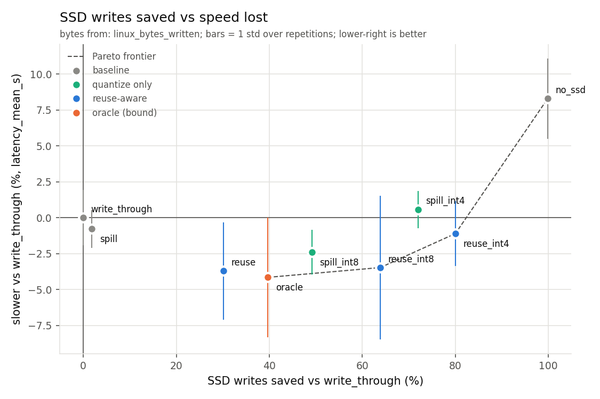
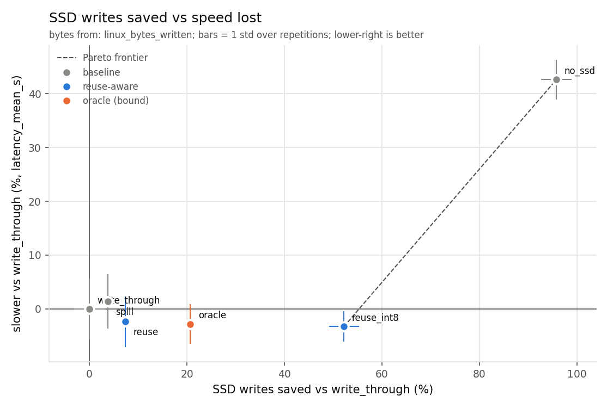

# kvwear: KV-Cache Offloading and SSD Wear on Consumer Hardware

**kvwear** is a measurement framework and policy study for on-device LLM inference that offloads
the attention KV cache from GPU to RAM to SSD. It answers two questions:

1. **How much does KV-cache offloading actually wear out a consumer NVMe SSD?** Measured with the
   drive's own SMART host-write counter, bracketing every run, with background writes and a
   zero-write control subtracted.
2. **How many of those writes are unnecessary, and can a smarter tier avoid them without slowing
   inference down?** Answered with a reuse-aware SSD admission policy, combined with KV
   quantization, evaluated against write-through, write-back, a no-SSD lower bound and a
   future-knowing oracle.

**Headline result.** On an RTX 3050 Laptop GPU with a Samsung PM9A1 NVMe SSD, a reuse-aware int8
admission policy (`reuse_int8`) cut KV writes to the SSD by **64–76% versus write-through, with
no measurable latency cost**, while keeping **99.0% top-1 next-token agreement** with the exact
fp16 cache (OPT-1.3B). The same policy saves **62%** on Qwen2.5-0.5B (a modern grouped-query-attention
model) and **52%** in an 8–12K-token long-document setting. In that setting, dropping the SSD tier
altogether makes requests **43% slower**.

**GPU acceleration (CUDA).** Hand-written CUDA kernels move the KV codec and the cache-loading path onto
the GPU, bit-identical to the CPU codec so every wear result still holds. The quantizers reach
**177 GB/s (94% of the GPU's DRAM peak, 23× a naive kernel)**, a request's cached prefix is
loaded **8–25× faster** with one pipelined copy and one dequantize-and-scatter launch, SSD encoding
runs on its own CUDA stream fully hidden behind model compute, and a paged flash-decoding kernel
attends **directly over int8 KV blocks**, 1.95× faster than the same algorithm on fp16 and **4×
faster than PyTorch SDPA** at 32K tokens. End to end, quantized policies get **47–60% lower
time-to-first-token** with identical SSD writes, and an int8 GPU KV cache makes long-context
generation **2.18× faster** with half the KV memory. Details: [docs/CUDA.md](docs/CUDA.md).

---

## Contents

1. [Key results](#1-key-results)
2. [Contributions and novelty](#2-contributions-and-novelty)
3. [Background: why the KV cache hits the SSD](#3-background-why-the-kv-cache-hits-the-ssd)
4. [Related work](#4-related-work)
5. [System design](#5-system-design)
6. [Measurement methodology](#6-measurement-methodology)
7. [Experimental setup](#7-experimental-setup)
8. [Results in detail](#8-results-in-detail)
9. [Tests](#9-tests)
10. [Reproducing the experiments](#10-reproducing-the-experiments)
11. [Repository layout](#11-repository-layout)
12. [Limitations and threats to validity](#12-limitations-and-threats-to-validity)
13. [Future work](#13-future-work)
14. [GPU acceleration (CUDA)](#14-gpu-acceleration-cuda)

---

## 1. Key results

All policy comparisons use the same token trace, 3 repetitions per policy, with write-through as
the baseline. Saved-% comes from the Linux block-device counter. SMART is used for absolute wear
(see [§6.3](#63-which-byte-counter-to-trust)).

| Setting | `reuse` saved | `reuse_int8` saved | `reuse_int8` latency | Oracle bound |
|---|---|---|---|---|
| OPT-1.3B, 256 MB RAM tier | 30% | **64%** | −3% (±5) | 40% |
| OPT-1.3B, 1000-token context | 54% | **76%** | +6.5% (±12) | 82% |
| Qwen2.5-0.5B, short context | 26% | **62%** | −1% | 37% |
| Qwen2.5-0.5B, 8–12K-token documents | 7% | **52%** | −3% | 21% |

The oracle row admits only blocks that the future trace reads again, in fp16. It bounds admission
alone, not admission plus quantization.

Other findings:

* **At a 1 GB RAM tier, write-through wastes 100% of its SSD writes.** The working set fits in RAM,
  the SSD is never read, and an LMCache-style write-through disk tier still writes
  0.10 GB per chat (Linux) / 3.4 GB of SMART host writes per run. Reuse-aware admission writes ~0.
* **The WSL2 virtual disk amplifies writes by 1.4–2.0×.** The SSD absorbs 1.73× (1 GB RAM) to
  2.0× (256 MB RAM) more host writes than Linux reports for the same run, so wear estimates taken
  inside the VM understate real wear by up to half.
* **The page cache can swallow short-lived KV entirely.** A 25-second FlexLLMGen run that
  created 0.43 GB of KV files once wrote 0.42 GB to the device and once 0.001 GB. The files
  were deleted before writeback, so short benchmarks can report zero SSD wear.
* **KV bytes per token decide the wear.** OPT-1.3B (no GQA) stores 192 KiB/token. Qwen2.5-0.5B stores
  12 KiB/token (16× less) and writes ~14× less per chat. The percentage savings carry over between
  the two models (62–64% for `reuse_int8`).
* **Off-the-shelf offloading (FlexLLMGen, KV 100% on disk):** 5.1 ± 0.8 GB of SMART writes per run.
  Its built-in 4-bit `--compress-cache` reduces this to 2.4 ± 0.8 GB (Linux counter: −71%).
* **Quality cost of quantized KV (OPT-1.3B):** int8 keeps 99.0% top-1 agreement (perplexity
  +0.05%). int4 keeps 81.6% (perplexity +2.5%). int4 saves more writes but is not free.



---

## 2. Contributions and novelty

1. **SSD endurance as a first-class metric for KV offloading.** Prior KV-offloading systems
   optimize throughput or latency and treat the SSD as an infinitely rewritable tier. kvwear
   measures wear **at the drive** (NVMe SMART *Data Units Written*), brackets every single run,
   subtracts measured background writes and a zero-KV control run, and reports GB per 1,000
   tokens, GB per chat and projected % of the drive's TBW rating per year.

2. **KV-to-SSD admission treated as a flash-cache admission problem.** Flash caches long ago
   learned not to write everything (Flashield, RIPQ, Kangaroo). This project applies that lesson
   to KV blocks. The `ReuseAware` admission filter runs when RAM evicts a block and combines four
   signals:
   * **ghost list**: a dropped block that gets requested again is marked "proven" and always
     admitted afterwards, so the filter corrects its own mistakes;
   * **shared**: blocks referenced by ≥ 2 conversations (system prompts, documents pasted by
     several users) are always kept;
   * **dead**: blocks no live conversation's context contains any more (superseded prefixes,
     truncated history) are dropped;
   * **continuation**: otherwise, the probability that an owning conversation returns for
     another turn, from turn number, document presence and how long it has been idle, fitted on
     a *separate* training trace.

3. **Two orthogonal levers, measured together.** Admission ("write fewer blocks") and
   quantization ("write each block smaller": int8 per-group absmax, int4 asymmetric, optional
   zstd) are evaluated alone and combined, against both bounds (`no_ssd`, `oracle`), on the same
   trace. Their effects compound: 30% (admission alone) + 49% (int8 alone) → 64% together.

4. **A measurement methodology for wear on a virtualized consumer stack.** The idle-window rate
   subtraction, the `no_ssd` control, dual counters with stated noise, cache flushing at both
   the Linux and Windows layers, and shuffled policy order yield the findings above about the
   virtual disk and the page cache. These systematic effects would invalidate naive measurements.

5. **Why the policy cannot live inside single-request offloaders.** In FlexLLMGen-style offloading,
   every decode step re-reads the entire KV cache, so within one generation every block written is
   read again and there is nothing to skip. Savings exist only *across* requests (multi-turn
   chats, shared documents, abandoned conversations), which is why kvwear uses a multi-turn
   engine with a persistent tiered store.

6. **Robustness checks:** a modern GQA model (Qwen2.5-0.5B), a long-document regime where SSD
   loading beats recomputing, and a distribution-shift test of the reuse predictor.

7. **A GPU data path for compressed KV** ([§14](#14-gpu-acceleration-cuda)): CUDA quantize /
   dequantize kernels at the DRAM-bandwidth limit, a single-launch batched loader that ships blocks
   over PCIe still compressed, stream-overlapped encoding, and paged attention that consumes the
   on-SSD int8 format directly, so compression saves SSD wear *and* GPU memory bandwidth.

---

## 3. Background: why the KV cache hits the SSD

During autoregressive decoding, each transformer layer caches the keys and values of all previous
tokens. For a model with `L` layers, `H_kv` KV heads and head dimension `d`, in fp16:

```
bytes per token = L × 2 (K and V) × H_kv × d × 2 bytes
OPT-1.3B:      24 × 2 × 32 × 64 × 2 = 196,608 B  (192 KiB/token)
Qwen2.5-0.5B:  24 × 2 ×  2 × 64 × 2 =  12,288 B  ( 12 KiB/token, grouped-query attention)
```

A 2,000-token OPT-1.3B conversation therefore holds ~375 MiB of KV. A 4 GB laptop GPU cannot
keep many of those, so systems spill KV to host RAM and then to SSD (FlexLLMGen, LMCache's disk
backend, vLLM CPU/disk offload). Multi-turn chat reuses a conversation's prefix KV on the next
turn, which is why KV is worth keeping at all. But every block written to an SSD consumes
endurance (consumer drives are rated in the low hundreds of TBW), whether or not it is ever read
back.

Where never-reused KV comes from in multi-turn chat:

* the last turn of every conversation (nothing follows it);
* conversations the user abandons after one or two turns;
* blocks invalidated when long histories are truncated (dropping the oldest turns changes
  every following block's prefix hash);
* one-off content such as a pasted error log that appears in a single turn.

---

## 4. Related work

**KV-cache offloading for inference.**
*FlexGen / FlexLLMGen* (Sheng et al., ICML 2023) offloads weights and KV across GPU, CPU and disk
for high-throughput batch inference. It is the step-1 baseline here, and its 4-bit group-wise
`--compress-cache` is the reference scheme for the `int4` codec. *vLLM / PagedAttention*
(Kwon et al., SOSP 2023) introduced block-granular KV management and prefix caching. *LMCache*
provides a multi-tier KV store (GPU → CPU → disk) with prefix-chained block hashing, which
kvwear's `blocks.py` follows. Its disk tier writes through, which is the `write_through` baseline.
*CachedAttention / AttentionStore* (Gao et al., USENIX ATC 2024) keeps multi-turn KV in a
hierarchical cache to avoid recomputation. *Mooncake* (FAST 2025) builds a KV-cache-centric serving
architecture around a disaggregated KV store. *SGLang's RadixAttention* reuses KV across requests
with a radix tree of prefixes. These systems optimize hit rate, throughput and time-to-first-token.
None of them models or limits SSD endurance.

**KV-cache quantization.**
*KIVI* (Liu et al., ICML 2024) and *KVQuant* (Hooper et al., NeurIPS 2024) quantize KV caches to
2–4 bits with small accuracy loss. kvwear uses deliberately simple group-wise int8/int4 and
measures its quality cost directly (top-1 agreement, KL divergence, perplexity) because the goal
is the write reduction, not a new quantizer.

**Flash caching and admission control.**
*Flashield* (Eisenman et al., NSDI 2019) uses a DRAM-resident learned filter to decide which
objects are written to flash, explicitly to limit write amplification and wear. *RIPQ* (Tang et al.,
FAST 2015) and *Kangaroo* (McAllister et al., SOSP 2021) design flash caches around write
patterns and endurance, and *CacheLib* (Berg et al., OSDI 2020) deploys admission policies for flash
in production. kvwear's `ReuseAware` admission is a direct transfer of this idea to KV blocks.
It adds two signals that only exist for KV: structural sharing (prefix hashes shared across
conversations) and structural death (blocks unreachable after truncation).

**SSD wear measurement.**
SMART/NVMe health logs expose host writes ("Data Units Written", 512,000-byte units) but not
NAND writes, so they bound wear from below. Virtualized and layered filesystems add host-side
write amplification. kvwear quantifies that for WSL2's ext4-in-VHDX stack.

---

## 5. System design

```
                 multi-turn synthetic workload (identical trace for every policy)
                                         │
                                         ▼
 ┌──────────────────────────── engine (engines/hf.py) ─────────────────────────────┐
 │ prompt → block hashes → lookup longest cached prefix → rebuild DynamicCache     │
 │        → prefill only the uncached tokens (chunked) → greedy decode             │
 │        → hand the KV of new full blocks back to the store                       │
 └─────────────────────────────────────────────────────────────────────────────────┘
                                         │
                                         ▼
 ┌──────────────────────────── TieredKVStore (store.py) ───────────────────────────┐
 │  RAM tier (LRU, byte budget)  ──evict──►  admission policy (policy.py)           │
 │                                             │ admit?        │ drop               │
 │                                             ▼               ▼                    │
 │                               codec (codecs.py)         recompute later          │
 │                               fp16 / int8 / int4 (+zstd)                         │
 │                                             │                                    │
 │                                             ▼                                    │
 │                               SSD tier (LRU, async writer thread, backpressure)  │
 └─────────────────────────────────────────────────────────────────────────────────┘
                                         │
       counters: app bytes · /proc/diskstats · SMART (Windows, around each run)
```

### 5.1 Workload (`kvwear/workload.py`)

Synthetic multi-turn chats designed to contain every reuse pattern described above:

| Kind | Share | Content | Reuse pattern |
|---|---|---|---|
| `doc_qa` | 35% | one of `num_shared_docs` shared documents + questions | shared across users, many turns |
| `debug` | 30% | one-off pasted error log in one turn | log KV is one-off |
| `general` | 35% | short chit-chat | often abandoned after 1–2 turns |

All conversations share a system prompt. `concurrency` conversations are open at once and their turns
interleave randomly, so a conversation's KV must survive other requests. Prompts longer than
`max_context_tokens` drop their oldest turns, which invalidates later blocks. Assistant turns in
the history are scripted, and the model's own decoded tokens are timed but discarded, so **every
policy sees exactly the same token sequence** and differences come only from the policy.

### 5.2 Blocks (`kvwear/blocks.py`)

Prompts are split into 64-token blocks identified by a chained BLAKE2b hash of the block's tokens
and its parent's hash (as in vLLM/LMCache prefix caching). A block's hash therefore identifies its
whole prefix, so a lookup returns the longest cached prefix. One OPT-1.3B block is 12 MiB (fp16),
and one Qwen2.5-0.5B block is 768 KiB.

### 5.3 Admission policies (`kvwear/policy.py`)

`--policy` takes a preset or a spec `admission[@threshold]/codec`, e.g. `reuse@0.3/int4+zstd`.

| Preset | Admission | Codec | Role |
|---|---|---|---|
| `write_through` | write every new block | fp16 | **baseline**: LMCache-style disk tier |
| `spill` | write when RAM evicts it | fp16 | simple write-back |
| `spill_int8`, `spill_int4`, `spill_fp16_zstd` | on eviction | quantized / compressed | quantization alone |
| `reuse` | on eviction, **only if predicted reuse ≥ threshold (0.5)** | fp16 | admission alone |
| `reuse_int8`, `reuse_int4` | reuse-aware | int8 / int4 | both levers |
| `oracle`, `oracle_int4` | only blocks the future trace reads again | fp16 / int4 | upper bound (not implementable) |
| `no_ssd` | never | — | lower bound on writes; shows the cost of recomputing |

`ReuseAware` scores an evicted block as follows, in order. The block is written to SSD if the score
is ≥ the threshold.

| Condition | Score |
|---|---|
| proven by the ghost list (dropped earlier, then requested again) | 1.0 |
| shared by ≥ 2 conversations | 1.0 |
| dead: no live conversation's context contains it | 0.0 |
| otherwise | max over owning conversations of P(return) |

`ContinuationModel` computes P(return) with Bayes' rule:

```
p_cont(turn, has_doc) = P(turn is not the conversation's last)    (Laplace-smoothed frequencies)
S(g)                  = P(gap between turns > g requests)         (empirical survival function)
P(return | idle g)    = p·S(g) / (p·S(g) + (1 − p))
```

The model is fitted on a trace generated with a different seed from the one evaluated (and, for
the shift test, from a differently shaped workload via `--train-set`). Sweeping the threshold
(`reuse@0.2/fp16` … `reuse@0.8/fp16`) traces the trade-off curve.

The oracle is given the complete future trace and admits exactly the blocks that will be read
again. A guard (`on_lookup_done` / `in_lookup`) stops it from discarding blocks the current
request still needs.

### 5.4 Codecs (`kvwear/codecs.py`)

| Codec | Scheme | Size vs fp16 |
|---|---|---|
| `fp16` | raw | 1.00× |
| `int8` | per-group absmax, group 64 along head_dim | ~0.516× |
| `int4` | asymmetric min/max per group 64, two values per byte (FlexLLMGen's `--compress-cache` scheme) | ~0.281× |
| `+zstd` / `+zlib` | optional lossless pass on top | data-dependent |

Each encoded block carries a self-describing header (method, shape, group, compression), so
decoding needs no side information. There are two backends: numpy, and torch, which is 3–5× faster.
They produce byte-identical output, and a test enforces this.

### 5.5 Store (`kvwear/store.py`)

`TieredKVStore` holds a RAM tier (LRU under a byte budget) and an SSD tier (one file per block in a
dedicated directory, LRU under a capacity budget). SSD writes go through an asynchronous writer
thread with a bounded pending queue (backpressure time is recorded). Reads use preallocated
buffers and `readinto`. Optional `fsync` and `bypass_page_cache` (fsync plus
`posix_fadvise(DONTNEED)`) make SSD hits really read the device. The offload directory is guarded
by a marker file: the store refuses to wipe a non-empty directory it did not create.

### 5.6 Engines (`kvwear/engines/`)

* **`hf`**: a real model on HuggingFace transformers. It rebuilds a `DynamicCache` from reused blocks,
  runs chunked prefill of the uncached suffix (fits a 4 GB GPU), greedy-decodes and extracts the KV of new full
  blocks. Shapes (layers, KV heads, head dim) come from the model config, so GQA models work
  unchanged.
* **`sim`**: a no-GPU stand-in. It produces correctly shaped tensors, models compute time and
  performs *real* SSD writes. It is used for policy development and tests. Its speed numbers are
  never reported.
* **`flexgen`**: drives FlexLLMGen with `--percent` placing 100% of the KV cache on disk,
  parses its output and samples the offload directory size every second.

### 5.7 Measurement and analysis

* `kvwear/diskstats.py`: maps the offload directory to its block device and reads
  `/proc/diskstats` before/after (sectors written × 512).
* `windows/SmartLogger.psm1`: reads NVMe SMART via `smartctl -d nvme` (Data Units Written ×
  512,000 B), flushes every fixed volume (`Write-VolumeCache`).
* `windows/run_experiment.ps1`: the bracketed loop (see §6), resumable after interruption.
* `windows/run_all.ps1`: the staged unattended campaign. It keeps the PC awake, pauses OneDrive
  and restarts it afterwards.
* `kvwear/analysis.py`: idle subtraction, control attribution, per-policy aggregates with error
  bars, wear projection, trade-off plots with the Pareto frontier.
* `kvwear/quality.py`: top-1 agreement, KL divergence and perplexity of int8/int4 KV against
  the exact fp16 cache.

---

## 6. Measurement methodology

### 6.1 Per-run protocol

For every repetition, with the policy order shuffled per repetition to spread drift:

1. Read the SSD's lifetime host-write counter (SMART).
2. Run one policy in WSL2 (`python -m kvwear.runner`). The runner also records app-level bytes
   and `/proc/diskstats` for the offload device.
3. `sync` inside Linux, flush the Windows volume cache on all fixed volumes, wait 20 s for the
   counter to settle.
4. Read SMART again. The delta is what the run wrote, plus background noise.

### 6.2 Removing noise

* **Idle windows.** WSL runs `sleep` (no LLM) for 180 s before and after each stage, with the same
  flush/settle. They give a background write rate (≈1.4 GB/h on this machine). *Rate × window*
  is subtracted from every run.
* **Zero-KV control.** `no_ssd` writes no KV, yet still costs 1.2 ± 0.5 GB of SMART writes
  (Windows paging while the VM holds the model). This control is subtracted to get
  KV-attributable SMART bytes (`smart_kv_bytes`).
* **Environment.** OneDrive was stopped during the measurements, the laptop was on mains power,
  and the offload directory was on the WSL ext4 disk (never on `/mnt/c` or a synced folder).
* **Warm-up.** One unmeasured run per multi-turn stage downloads and loads the model.
* **Fresh filesystem.** The first run after creating the WSL disk showed ~1.9 GB of ext4
  lazy-init writes and was discarded.

### 6.3 Which byte counter to trust

| Counter | Noise | Used for |
|---|---|---|
| App bytes (store) | exact | sanity check (matches Linux within ~1%) |
| `/proc/diskstats` (Linux) | ±0.1% | **comparing policies** (saved-%) |
| SMART − idle − `no_ssd` control | ±0.5–1 GB per run | absolute wear, virtual-disk amplification |

SMART's per-run noise is as large as the signal for the cheapest policies (e.g. `reuse_int4` read as
98% saved by SMART vs 80% by Linux), so saved-% always comes from Linux. SMART is the ground truth
for what the drive absorbed and therefore for wear.

### 6.4 Known pitfalls (handled)

* **Page cache:** see the finding in §1. `configs/flexgen.yaml` is sized so the cache outlives the
  writeback window (3.6 GB, ~4 min).
* **SMART granularity:** 512,000-byte units, and some drives update lazily. Hence the settle wait and
  runs that write ≫ 1 GB.
* **Host vs NAND writes:** SMART counts host writes, and internal SSD write amplification comes on top.
  Projections are therefore lower bounds on wear.

---

## 7. Experimental setup

| Component | Detail |
|---|---|
| GPU | NVIDIA RTX 3050 Laptop, 4 GB |
| SSD | Samsung PM9A1 512 GB NVMe (OEM twin of the 980 PRO 500 GB, rated 300 TBW; that rating is assumed) |
| OS | Windows 11, WSL2 Ubuntu 22.04 (7.6 GB RAM visible to the VM; virtual disk on the same physical SSD) |
| Software | Python 3.10, torch 2.5.1+cu121, transformers 4.51.3, numpy 1.26.4, smartmontools 7.5 |
| FlexLLMGen | commit `004ffef82b46e8dc8685c55d0cdda650bdaf1269` + `linux/flexllmgen-laptop.patch` |
| Models | OPT-1.3B (fp16), Qwen2.5-0.5B-Instruct (fp16), OPT-125m for smoke tests |

Experiment configurations:

| Config | Model | Workload | RAM tier |
|---|---|---|---|
| `configs/default.yaml` | OPT-1.3B | 20 chats, concurrency 4, 700–1000-token docs, 2000-token context | 1024 MB / 256 MB |
| `… workload.max_context_tokens=1000` | OPT-1.3B | same, aggressive truncation | 256 MB |
| `configs/qwen.yaml` | Qwen2.5-0.5B | same as default | 16 MB (same token capacity as 256 MB on OPT) |
| `configs/qwen_long.yaml` | Qwen2.5-0.5B | 16 chats, 8–12K-token shared docs, 16K context | 64 MB |
| `configs/flexgen.yaml` | OPT-1.3B (FlexLLMGen) | prompt 1024, gen 128, batch 4 × 4 (3.6 GB KV) | KV 100% on disk |

**FlexLLMGen patch.** Upstream pins a 2 GiB relay buffer per disk-copy thread (4 threads = 8 GiB
of pinned memory), more than the 7.6 GB available to the WSL2 VM. A copy thread died with CUDA OOM and
the run hung with an empty offload folder. The patch sizes the buffer from `FLEXLLMGEN_PIN_BUF_MB`
(default 256 MB) and grows it on demand. Unpatched FlexLLMGen was not retested with a larger WSL
memory limit.

---

## 8. Results in detail

Raw rows: `results/final/experiments_*.csv` (one row per run, including SMART before/after,
Linux and app counters, latency and TTFT statistics, store statistics). Reports and plots:
`results/final/report_*/`. Preliminary Linux-only sweeps: `results/prelim/`.

### 8.1 Off-the-shelf offloading damage (FlexLLMGen, KV 100% on disk)

| | SMART (KV-attributable) | Linux | Decode tok/s |
|---|---|---|---|
| FlexLLMGen | 5.1 ± 0.8 GB per run | 3.63 GB | 10.2 |
| `--compress-cache` (4-bit) | 2.4 ± 0.8 GB (−54%) | 1.05 GB (−71%) | 10.1 |

Compression costs no decode speed here, but it cannot avoid writes: within one generation, every
block written is read back on every decode step.

### 8.2 OPT-1.3B, 256 MB RAM tier (the main result)

Linux counter. Latency is the mean turn latency. Differences |Δ| under ~4% are within run-to-run noise.

| Policy | Writes saved | Latency Δ | TTFT Δ |
|---|---|---|---|
| `spill` | 2% | −1% | −4% |
| `reuse` | 30% | −4% | −12% |
| `oracle` (bound) | 40% | −4% | −14% |
| `spill_int8` | 49% | −2% | −10% |
| **`reuse_int8`** | **64%** | **−3% (±5)** | −13% |
| `spill_int4` | 72% | +1% | +4% |
| `reuse_int4` | 80% | −1% | −5% |
| `no_ssd` | 100% | +8% | −14% |

Writes per chat for write-through: 0.100 GB (Linux). Virtual-disk amplification (SMART ÷ Linux,
fp16 write-through): 2.0×.

### 8.3 OPT-1.3B, 1000-token context, 256 MB

Truncation invalidates later blocks every turn, so much more KV is dead on arrival. Baseline writes
triple (6.0 GB/run vs 2.0 GB).

| Policy | Writes saved | Latency Δ |
|---|---|---|
| `reuse` | 54% | +1.5% (±21) |
| **`reuse_int8`** | **76%** | +6.5% (±12) |
| `oracle` (bound) | 82% | −2% (±21) |

The baseline's ±21% spread in this stage means the latency differences are **not resolved**. Only
the write reductions are.

### 8.4 OPT-1.3B, 1 GB RAM tier

The working set fits in RAM and the SSD is never read. Write-through still writes 0.10 GB per chat
(Linux; 3.4 GB SMART per run). That is **100% wasted endurance**. `spill` saves 54%, and the
reuse-aware policies save 99.7–99.8% (the same as `no_ssd`).

### 8.5 Quality of quantized KV (OPT-1.3B, 20 samples)

| Codec | Top-1 agreement with fp16 | KL divergence | Perplexity |
|---|---|---|---|
| int8 | **99.0%** | 0.00026 | 182.30 (+0.05%) |
| int4 | 81.6% | 0.072 | 186.78 (+2.5%) |

Source: `results/prelim/quality_opt-1.3b.json`.

### 8.6 Modern GQA model: Qwen2.5-0.5B

| Setting (Linux counter) | Write-through GB/chat | `reuse` saved | `reuse_int8` saved | `no_ssd` latency vs write-through |
|---|---|---|---|---|
| OPT-1.3B, 256 MB RAM | 0.100 | 30% | 64% | +8% |
| Qwen2.5-0.5B, 16 MB RAM, ~1K-token docs | 0.007 | 26% | 62% | −1% |
| Qwen2.5-0.5B, 64 MB RAM, 8–12K-token docs | 0.014 | 7% | 52% | **+43%** |

* The relative savings transfer to the GQA model, but **absolute wear per chat is ~14× lower**. At
  50 chats/day, short-context Qwen writes ~130 GB/year (~0.04% of 300 TBW, Linux counter, before
  the 1.4–2× virtual-disk factor). The OPT-1.3B projection (§8.8) is specific to OPT-class KV sizes.
* **Long documents justify the SSD tier.** Recomputing 8–12K-token documents (`no_ssd`) is 43%
  slower than loading them (mean TTFT 0.83 s vs 0.21 s), while `reuse_int8` is no slower than
  write-through and writes 52% less.
* In the long-document setting, `reuse` alone saves only 7%. Most long-document blocks are shared
  and worth keeping, so the gain there comes from quantization.
* Short-context Qwen wear is a few MB per chat, close to the background noise floor. Those
  percentages are indicative, and SMART is too coarse to resolve them (it reported negative KV
  bytes for some long-document policies).



### 8.7 Reuse-predictor distribution shift

The predictor is trained on a deliberately different workload (80% general chats, 1–3 turns per
conversation, 8 shared documents) and evaluated on the normal OPT-1.3B / 256 MB workload:

| | SSD hits | Writes (Linux) | Writes per SSD hit | Tokens recomputed |
|---|---|---|---|---|
| Trained in-distribution | 391 | 1.39 GB | 3.6 MB | 13,627 |
| Trained on shifted workload | 333 | 1.15 GB | 3.5 MB | 17,339 |

The mismatched predictor becomes more conservative: 17% fewer writes, 15% fewer SSD hits and 27%
more recomputation. Writes per useful hit are unchanged, so it **moves along the trade-off curve
rather than collapsing**. This is because the structural signals (ghost list, shared, dead) do not
depend on the learned statistics. The shifted run's latency was measured on a different day and is
not compared.

### 8.8 Wear projection

With OPT-1.3B at 1 GB RAM, write-through produces ~0.2 GB of SMART writes per 1,000 tokens, or
~0.6–1.0 GB per average chat. At 50 chats/day that is **~4–6% of a 300 TBW rating per year**
(17–27 years to the rating). For Qwen2.5-0.5B it is well under 1% per year. In both cases
`reuse_int8` cuts the figure by roughly two thirds. Wear scales linearly with KV bytes per token:

```
python -m kvwear.analysis project --gb-per-chat 2 --chats-per-day 50 --tbw-tb 300   # worked example
```

### 8.9 Takeaways

1. Admission alone reaches 26–54% depending on the workload and tracks the oracle bound (37–82%).
   Quantization alone reaches 48–49% (int8).
2. **Together (`reuse_int8`): 52–76% fewer writes, no resolvable latency cost, 99% top-1 agreement.**
   This is the recommended operating point. int4 saves more but costs accuracy.
3. Whether to offload at all depends on recompute cost. For short contexts on a small model,
   recomputation is cheap (`no_ssd` is competitive). For long shared documents, the SSD tier pays
   for itself.
4. Naive measurements mislead in both directions. The page cache can hide all writes, and the
   virtual disk can double them.

---

## 9. Tests

`pytest` suite: **120 tests, all passing** in WSL with the GPU (37 core tests + 83 CUDA tests,
~30 s). The 37 core tests need no GPU and also pass on Windows; the CUDA tests skip themselves
when no GPU or `nvcc` is present. The end-to-end tests use the `sim` engine and real file I/O in a
temporary directory.

```
py -3.10 -m pytest -q tests                        # Windows (core tests; CUDA tests skip)
bash linux/cuda_env.sh python -m pytest -q tests   # WSL with GPU: all 118
```

| File | What is verified |
|---|---|
| `test_codecs.py` (9) | fp16 is bit-exact; int8/int4 error and size bounds for both backends (relative error ≤ 1% / 20%, size ≤ 0.53× / 0.29×); numpy and torch backends produce identical bytes; zstd/zlib round-trip; odd head dims and constant groups; malformed input rejected |
| `test_store.py` (14) | write-through writes each unique block exactly once; spill writes only on eviction; `no_ssd` never writes; lookup returns the longest prefix and promotes it; SSD capacity eviction deletes files; async writer correctness; quantized policies write fewer bytes; reuse-aware drops dead and keeps shared blocks; ghost list proves blocks; oracle writes only reused blocks and keeps blocks the current lookup needs; refuses to wipe a foreign directory; policy-spec parsing; continuation-model Bayes estimates |
| `test_workload.py` (7) | determinism per seed; every turn emitted once with a correct last-turn flag; context budget respected; shared system prompt yields shared blocks; each turn extends the previous prefix; gap statistics; block-hash prefix property |
| `test_cuda.py` (83) | every quantize optimization stage (v0–v4) produces **byte-identical** output to the CPU codec on 5 shapes incl. odd group sizes and misaligned payloads (fallback paths); GPU dequantize equals CPU decode exactly; zlib/zstd blocks; the batched loader equals CPU decode + concatenate for mixed fp16 / int8 / int4 blocks; the store writes identical SSD files and counts with `codec_device=cuda`; the runner writes identical bytes; paged int8 attention v1–v3 within 2e-3 of an fp32 reference (MHA, GQA, head_dim 64/128, partial blocks); the int8 GPU generation cache appends bit-exactly and decodes within 2e-3 |
| `test_end_to_end.py` (7) | full sim run across policies (`no_ssd` writes 0, `oracle` < `write_through`, `spill` ≤ `write_through`, int4 < 0.35× fp16, identical trace for every policy, recomputation bounds); analysis report generation; idle-rate subtraction; KV attribution via the `no_ssd` control; wear-projection arithmetic; FlexLLMGen command builder and output parser; dotted config overrides |

Beyond unit tests, each campaign starts with a **validation stage**: a check that the offload
folder grows, that Linux writes match the folder size and that SMART moves, followed by a tiny
SMART-bracketed run. The campaign aborts if SMART does not move. Validation result:
write-through SMART delta 0.241 GB vs app 0.144 GB and Linux 0.148 GB.

---

## 10. Reproducing the experiments

### 10.1 Prerequisites (Windows host)

```powershell
winget install smartmontools.smartmontools
wsl --install -d Ubuntu-22.04 --location D:\WSL\Ubuntu-22.04   # any location on the SSD under test
```

In an **elevated** PowerShell (SMART needs administrator rights), check that SMART works:

```powershell
.\windows\log_smart.ps1 -ListDevices
.\windows\log_smart.ps1 -Label test
```

### 10.2 WSL environment (once)

```bash
cd /mnt/c/path/to/this/repo
bash linux/setup_wsl.sh
```

This creates `~/.venvs/kvwear` (pinned torch/transformers/numpy), clones FlexLLMGen at the pinned
commit, applies the laptop patch and downloads the OPT weights. Everything lives on the Linux ext4
disk. `linux/pip-freeze.txt` and `linux/flexllmgen-commit.txt` record the exact environment.

### 10.3 Sanity check

```powershell
.\windows\week1_check.ps1          # elevated; FlexLLMGen + multi-turn engine, folder size vs Linux vs SMART
```

### 10.4 Full campaign

```powershell
# elevated; plugged in; other apps closed
powershell -ExecutionPolicy Bypass -File windows\run_all.ps1
# extra stages:
powershell -ExecutionPolicy Bypass -File windows\run_all.ps1 -Stages qwen,qwen_long,shift
```

| Stage | Output |
|---|---|
| `validate` | `results/final/validation.csv` |
| `ram1024`, `ram256`, `ctx1000` | `results/final/experiments_ram*.csv` |
| `flexgen`, `flexgen_compress` | `results/final/experiments_flexgen*.csv` |
| `qwen`, `qwen_long` | `results/final/experiments_qwen*.csv` |
| `shift` | `results/final/experiments_ram256_shift.csv` |

Progress goes to `results/final/status.txt`. Runs are resumable: completed (policy, repetition) pairs
are skipped on relaunch.

Single experiments:

```powershell
.\windows\run_experiment.ps1 -Reps 3 -Set store.ram_mb=256 -OutCsv results\experiments_ram256.csv
.\windows\run_experiment.ps1 -Engine flexgen -Config configs/flexgen.yaml -Policies flexgen -Reps 3
.\windows\run_experiment.ps1 -Config configs/qwen.yaml -Policies reuse,reuse_int8 -TrainSet "workload.num_shared_docs=8"
```

### 10.5 Without SMART (no admin, Linux only)

```bash
bash linux/run_sweep.sh results/x 2 --set store.ram_mb=256
CONFIG=configs/qwen.yaml POLICIES="write_through reuse reuse_int8" bash linux/run_sweep.sh results/q 2
python -m kvwear.runner --config configs/default.yaml --policy 'reuse@0.3/int8+zstd'
python -m kvwear.runner --config configs/default.yaml --policy reuse \
    --train-set 'workload.mix={doc_qa: 0.1, debug: 0.1, general: 0.8}'      # predictor shift test
```

### 10.6 Analysis

```powershell
py -3.10 -m kvwear.analysis report --experiments results\final\experiments_ram256.csv `
    --source linux_bytes_written --tbw-tb 300 --chats-per-day 50 --out results\final\report_ram256_linux
```

Outputs: `summary.csv` / `summary.md` (GB per 1k tokens, GB per chat, % saved, % slower, TTFT,
years to TBW, % of TBW per year, virtual-disk amplification), `tradeoff.png` (writes saved vs
slowdown, Pareto frontier), `tradeoff_ttft_mean_s.png`, `writes_per_policy.png`.
`--source` chooses the counter (`linux_bytes_written`, `smart_kv_bytes`, `smart_llm_bytes`,
`app_bytes_written`). `--speed ttft_mean_s` switches the speed metric.

Quality:

```bash
python -m kvwear.quality --model facebook/opt-1.3b --codecs int8,int4 --samples 20 --out results/quality.json
```

### 10.7 Developing without a GPU

```powershell
py -3.10 -m kvwear.runner --config configs/smoke.yaml --engine sim --policy reuse_int4 --set store.offload_dir=C:\kvwear_offload
```

The `sim` engine performs real SSD writes with modelled compute time. Use it to iterate on
`policy.py`, and never report its speed numbers.

---

## 11. Repository layout

```
configs/              default.yaml, smoke.yaml, flexgen.yaml, qwen.yaml, qwen_long.yaml
kvwear/
  config.py           dataclass configs, YAML + dotted --set overrides
  workload.py         synthetic multi-turn chats (shared docs, one-off logs, abandonment, truncation)
  blocks.py           prefix-chained block hashes
  policy.py           admission policies, ReuseAware, ContinuationModel, Oracle, presets
  codecs.py           fp16 / int8 / int4 (+zstd/zlib), numpy and torch backends
  store.py            TieredKVStore: RAM LRU -> SSD LRU, async writer, counters
  engines/hf.py       real model engine (HF transformers)
  engines/sim.py      no-GPU engine with real SSD writes
  engines/flexgen.py  FlexLLMGen driver and parser
  diskstats.py        /proc/diskstats counters, offload-dir size monitor
  runner.py           one policy x one repetition -> results/runs/<id>/
  analysis.py         reports, wear projection, trade-off plots
  quality.py          top-1 agreement / KL / perplexity of quantized KV
  cuda/               CUDA kernels + bindings + benchmarks (see docs/CUDA.md)
    kvquant_kernels.cu   quantize v0..v4, dequantize, batched dequantize+scatter
    kvattn_kernels.cu    paged int8 flash-decoding attention v1..v3, fp16 baseline
    kvquant_bindings.cpp PyTorch bindings;  __init__.py: JIT build, GpuCodec, BlockLoader
    kvcache_kernels.cu + int8_cache.py   int8 GPU KV cache for generation (transformers hook)
    attention.py, bench.py, bench_attention.py, bench_overlap.py, bench_generate.py, compare_e2e.py
docs/CUDA.md          GPU design, optimization steps, benchmarks
linux/                setup_wsl.sh, check_offload.sh, run_sweep.sh, qwen_prelim.sh, cuda_env.sh,
                      cuda_e2e.sh, flexllmgen-laptop.patch, pinned versions
windows/              SmartLogger.psm1, KvwearWsl.psm1, log_smart.ps1, week1_check.ps1,
                      run_experiment.ps1, run_all.ps1
tests/                pytest suite (120 tests: 37 core + 83 CUDA)
results/cuda/         kernel / attention / overlap / end-to-end GPU benchmarks and plots
results/final/        SMART-bracketed campaign: raw CSVs, reports, plots
results/prelim/       Linux-only sweeps, quality results, FlexLLMGen runs
```

---

## 12. Limitations and threats to validity

* **Synthetic workload.** Turn counts, abandonment and sharing come from a generator, not a real
  chat trace. The shift test (§8.7) checks robustness to one change in these statistics, but it
  is still the same generator.
* **Small models.** OPT-1.3B and Qwen2.5-0.5B fit a 4 GB GPU. Larger models have more KV per token
  and higher recompute cost, which should favour offloading, but this is untested here.
* **Three repetitions.** Write reductions are tightly resolved (Linux counter ±0.1%). Several latency
  differences are not (±5–21%), so the latency claims are limited to "no measurable cost".
* **One machine, one SSD, virtualized.** WSL2 adds 1.4–2× host-side write amplification. Native Linux
  would write less to the drive for the same KV.
* **Host writes ≠ NAND writes.** SMART does not expose internal write amplification, so all wear
  figures are lower bounds.
* **Interrupted stage.** A power loss interrupted the first 256 MB stage. It resumed with the
  remaining runs about an hour later, under possibly different thermal and background conditions.
* **Oracle bound.** The oracle bounds admission in fp16, so quantized policies can exceed it.
  An `oracle_int8` bound would be the matching bound for `reuse_int8`.

---

## 13. Future work

* Replay real multi-turn statistics (e.g. turn-count and abandonment distributions from public
  chat logs) or a public prefix-reuse trace.
* `oracle_int8` and more repetitions for the latency comparisons.
* Larger models (7B-class with 4-bit weights) and longer contexts, where loading KV from SSD should
  dominate recomputation.
* Native Linux to separate KV writes from virtualization overhead.
* An endurance budget as an explicit control target: adapt the admission threshold online to stay
  under a TBW-per-year budget.
* Feed SSD-tier int8 blocks straight into the int8 GPU cache's block table (no fp16 round trip on
  SSD hits), and extend the int8 GPU cache to batched decoding and OPT's attention class.

---

## 14. GPU acceleration (CUDA)

Full write-up: [docs/CUDA.md](docs/CUDA.md). Hardware: RTX 3050 Laptop (Ampere sm_86, 16 SMs, 4 GB,
188 GB/s theoretical DRAM bandwidth, 177 GB/s measured device-to-device copy). Switch it on for any
experiment with `--set store.codec_device=cuda`; SSD bytes, hit/miss decisions and wear numbers are
identical to the CPU path, only time changes.

**Quantization kernels: optimization ladder** (192 MiB of OPT-1.3B KV, achieved DRAM bandwidth):

| Stage | Technique | int8 | int4 |
|---|---|---|---|
| v0 | one thread per group (uncoalesced) | 7.7 GB/s | 9.6 GB/s |
| v1 | warp per group, `__shfl_xor_sync` reductions, coalesced | 88 | 62 |
| v2 | `half2` vector loads/stores | 115 | 73 |
| v3 | group cached in registers, single global read | 128 | 80 |
| **v4** | sub-warp per group, 128-bit loads, 8/4-byte stores | **177** | **170** |
| PyTorch ops on the GPU (same math) | | 10.8 | 7.5 |

**Load path** (16 cached OPT-1.3B blocks = 1024 tokens into the attention cache): CPU decode +
concatenate + copy vs one pipelined pinned DMA + one dequantize/scatter kernel: fp16 273 → 33 ms
(8.4×), int8 264 → 19 ms (14×), int4 319 → 13 ms (25×); quantized blocks cross PCIe still
compressed.

**Overlap with CUDA streams:** encoding 60 × 12 MiB blocks during 30 model steps adds +49% when done
blocking, finishes 133% late on the CPU writer, and adds **+2%** on the GPU writer's own stream.

**Paged int8 decode attention** (one layer, one decode step, 32K tokens): OPT-1.3B 3245 µs (PyTorch
SDPA fp16) / 1563 µs (same kernel on fp16) / **803 µs int8** at 172 GB/s; Qwen2.5-0.5B with GQA head
packing 731 / 344 / **257 µs**. Dequantizing first and then calling SDPA is 8× slower than the fused
kernel.

**End to end on the real model** (same trace, `codec_device` cpu vs cuda, 3 reps): SSD bytes are
identical in every configuration; on OPT-1.3B with a 256 MB RAM tier, time-to-first-token drops
**47% (`reuse_int8`) to 60% (`spill_int4`)** and mean latency **13–19%** (run noise ±2%). So the
quantized policies that save the most SSD wear are now also faster than the uncompressed baseline.

**Generation with an int8 GPU KV cache** (Qwen2.5-0.5B, HF transformers `Cache` + attention hook):
decode is **2.18× faster at 31.7K tokens of context** (12.4 → 27.0 tok/s), KV memory is halved
(373 → 192 MB), and greedy next-token predictions agree with fp16 on 95–100% of steps.

---

## License

MIT — see [LICENSE](LICENSE).
