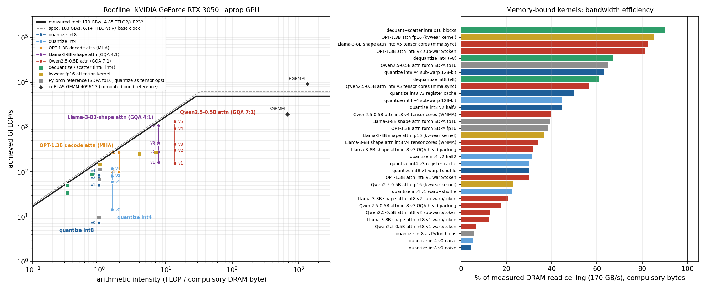
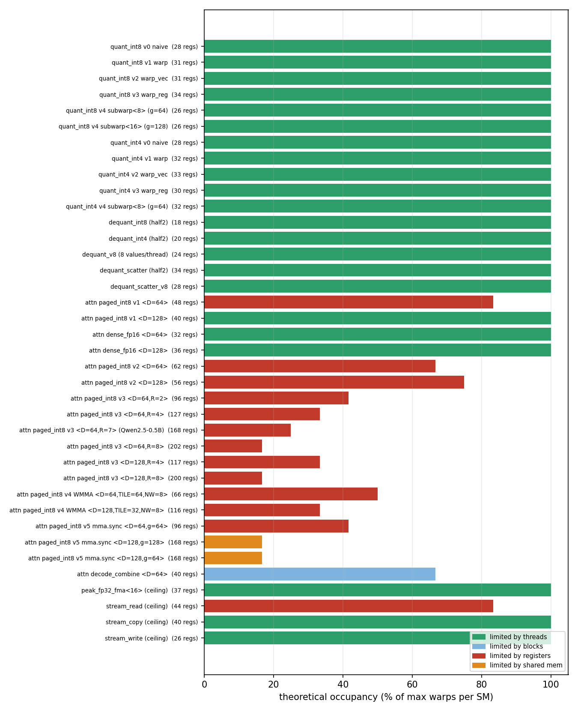

# kvwear CUDA: GPU kernels for KV-cache offloading

This part of kvwear moves the KV-cache codec and the cache-loading path onto the GPU, and adds a
decode-attention kernel that reads quantized KV blocks directly. Everything is hand-written CUDA C
(`kvwear/cuda/*.cu`), compiled with `nvcc` through `torch.utils.cpp_extension`, and benchmarked
on an RTX 3050 Laptop GPU (Ampere, sm_86, 16 SMs, 4 GB, 128-bit GDDR6, **188 GB/s theoretical**,
177 GB/s measured device-to-device copy).

| Component | File | What it does | Headline |
|---|---|---|---|
| Quantize kernels (5 optimization stages) | `kvquant_kernels.cu` | fp16 → int8 / int4 KV blocks, bit-identical to the CPU codec | **177 GB/s** (= memcpy ceiling, 94% of peak), **23×** over naive, **16×** over PyTorch ops |
| Batched dequantize + scatter | `kvquant_kernels.cu` | all cached blocks of a request → attention cache in **one launch**, DMA pipelined with host copies | load path **8–25×** faster than CPU decode + concat + copy |
| GPU codec on its own stream | `__init__.py` (`GpuCodec`) | SSD writer thread encodes on a private CUDA stream with pinned buffers | **4×** faster than multi-threaded CPU encode; encoding fully hidden behind model compute (+2% vs +49% blocking) |
| Paged int8 decode attention (5 stages) | `kvattn_kernels.cu` | flash-decoding over int8 blocks via a block table, no dequantize pass; v4/v5 run GQA on the **tensor cores** (WMMA, then raw `mma.sync` PTX, FlashAttention-2 style) | MHA: **1.95×** vs fp16 kernel, **4.0×** vs PyTorch SDPA (OPT, 32K); GQA: v5 is **2.3–2.4×** faster than the best CUDA-core kernel and **9–13×** faster than SDPA at 32K |
| Profiling: roofline + occupancy + Nsight Compute | `kvprof_kernels.cu`, `roofline.py`, `linux/profile_ncu.sh` | measured FP32/DRAM ceilings, every kernel on the roofline, registers/spills/occupancy from the CUDA runtime, one-command Nsight Compute report | the profile is what exposed v3 as latency-bound (18% of bandwidth) and led to v4/v5 |
| int8 GPU KV cache for generation | `kvcache_kernels.cu`, `int8_cache.py` | HF transformers `Cache` + attention hook: KV stays int8 on the GPU | Qwen2.5-0.5B decode **2.18× faster** at 31.7K context, KV memory halved, 95–100% next-token agreement |
| End to end (real model, same trace) | `store.codec_device=cuda` | GPU codec + loader inside kvwear's experiments | TTFT **−47% to −60%**, latency **−13% to −19%** for quantized policies on OPT-1.3B; identical SSD bytes |

All kernels are verified by `tests/test_cuda.py` (126 tests): byte-for-byte equality with the CPU
codec for every optimization stage and shape, exact equality of the GPU load path with the CPU
path, identical SSD files from the store, CUDA-core attention within 2e-3 and tensor-core attention
within 4e-3 of an fp32 reference (R = 2..16 query heads per KV head, D = 64/128, scale groups of
64/128, context lengths not divisible by 16, many and few splits).

---

## 1. Where the GPU fits in kvwear

```
            prefill/decode on GPU (HF transformers)
                     │ new KV blocks                        ▲ attention cache
                     ▼                                      │
   host RAM tier (fp16 blocks, LRU) ──evict──► admission ──┐│
                                                           ▼│
   SSD writer thread ─ GpuCodec: pinned H2D → quantize kernel → D2H (own CUDA stream)
                     │                                      ▲
                     ▼                                      │ BlockLoader: pinned H2D of still-
   SSD (block files, int8/int4, unchanged format)  ─────────┘ quantized blocks → 1 dequant/scatter launch
                     │
                     └──► PagedInt8KV: blocks uploaded as-is, decode attention reads int8 directly
```

Turned on with one switch, `--set store.codec_device=cuda`. The on-disk format, every write count
and every hit/miss decision are identical to the CPU path (the RAM tier accounts EncodedBlocks at
their logical fp16 size), so all SSD-wear results remain valid; only time changes.

---

## 2. Quantization kernels: an optimization ladder

The block format (shared with the CPU codec): groups of `g` = 64 consecutive values along
head_dim; int8 stores one fp16 scale (absmax/127) per group, int4 one fp16 scale and min per group
and two values per byte. Quantization is a **memory-bound** operation (≈ 0.5 flop/byte), so the
goal is to approach the DRAM bandwidth ceiling.

| Stage | Idea | int8 GB/s | int4 GB/s |
|---|---|---|---|
| v0 naive | 1 thread per group, serial loop over 64 values | 7.7 | 9.6 |
| v1 warp per group | 32 lanes share a group; `__shfl_xor_sync` butterfly reduction for absmax / min / max; adjacent lanes read adjacent values (**coalescing**) | 88 | 62 |
| v2 vectorized | `half2` 4-byte loads, `char2` stores: half the memory instructions | 115 | 73 |
| v3 register cache | the group stays in registers between the reduction and the quantize pass: global memory read **once** | 128 | 80 |
| **v4 sub-warp** | `g/8` lanes per group (a warp handles 4 groups), **128-bit loads** (8 halves per lane), 8-byte int8 / 4-byte int4 stores, shuffles confined to the sub-warp | **177** | **170–175** |
| dequantize (8 values/thread) | 8-byte int8 / 4-byte int4 load, one 16-byte store of 8 halves | 170 | 168 |
| reference: `cudaMemcpy` D2D | read + write of the same bytes | 177 | |
| reference: the same math as PyTorch GPU ops | 6 separate elementwise/reduction kernels, fp32 temporaries | 10.8 | 7.5 |

(192 MiB of OPT-1.3B KV, CUDA-event timing, median of 20.)


Why each step helps:

* **v0 → v1 (11×)**: in v0, lane *i* reads address `i × 128 B`, so each warp-wide load touches 32
  different cache lines. In v1 a warp reads 64 contiguous bytes. Coalescing is the single biggest win.
* **v1 → v2**: same bytes, half the load/store instructions (`half2`).
* **v2 → v3**: the second pass re-read the group from L1/L2; keeping it in registers removes that.
* **v3 → v4**: v3's lanes still issue 4-byte loads and 1–2-byte stores (int4: 32 lanes × 1 byte =
  a 32-byte warp store, poor DRAM efficiency). v4 issues 16-byte loads and 4–8-byte stores, so a
  warp moves 512 B per instruction. This closes int4's gap (80 → 175 GB/s).

**Bit-exact with the CPU.** The GPU must produce exactly the CPU bytes, or SSD write counts and
quality numbers would silently change. The kernels therefore use IEEE division (`__fdiv_rn`, no
`--use_fast_math`), round-half-to-even (`rintf`, as `torch.round`/`np.rint`), quantize with the
fp32 scale before storing it as fp16 (as the CPU does), and are compiled with `--fmad=false`
(plus `__fmul_rn`/`__fadd_rn`) because a fused multiply-add rounds differently from the CPU's
separate multiply and add. Tests compare bytes for all five stages, odd shapes (g = 16, 32, 128, 256,
groups not multiple of 4) and fallbacks (v4 drops to v3 when alignment does not allow 16-byte access).

---

## 3. The load path: one copy, one launch

When a request reuses cached prefix blocks (from RAM or SSD), they must become contiguous
`[layers, 2, heads, tokens, head_dim]` K/V tensors on the GPU before prefill.

**CPU path (before):** decode each SSD block on the CPU (int8/int4 → fp16), `np.concatenate` the
blocks, copy the result from pageable memory to the GPU, then a `.contiguous()` copy per layer.

**CUDA path (`BlockLoader`):**
1. pack every block's bytes (fp16 for RAM hits, *still-quantized* payloads for SSD hits) into one
   **pinned** buffer (16-byte aligned offsets);
2. async host-to-device copies from pinned memory (DMA at 12.7 GB/s vs 7.5–9 GB/s from pageable
   memory), **pipelined**: each block's DMA is issued as soon as its bytes are in the pinned buffer, so
   the copy engine moves block *i* while the CPU packs block *i+1* (cost ≈ max(memcpy, DMA), not the sum);
3. **one** kernel launch, `dequant_scatter`, with `blockIdx.y` = KV block: each CUDA block reads
   its method (fp16 copy / int8 / int4) from a small table, so the branch is uniform per CUDA
   block (no warp divergence); each thread decodes 8 values (one 8/4/16-byte load) and writes them
   with one 16-byte store **directly at their token offset** in the final cache tensor; per-layer
   K/V are views of that tensor (no further copies). A CUDA event guards the reused pinned buffer.

Quantized blocks cross PCIe compressed (int8: 0.52×, int4: 0.28× of fp16), so the GPU path moves
fewer bytes *and* skips the CPU decode.

| 16 cached OPT-1.3B blocks (1024 tokens, 192 MiB fp16) | CPU path | CUDA path | speedup | bytes over PCIe |
|---|---|---|---|---|
| fp16 | 273 ms | 33 ms | **8.4×** | 192 MiB |
| int8 | 264 ms | 19 ms | **14×** | 99 MiB |
| int4 | 319 ms | 13 ms | **25×** | 54 MiB |

(First version, one bulk copy after packing and a 2-values-per-thread kernel: 56 / 26 / 18 ms;
pipelining the DMA and widening the kernel's memory accesses gave a further 1.4–1.8×.)

This is on the time-to-first-token path of every request with a cache hit.


---

## 4. Encode on the writer thread: streams and pinned memory

The SSD writer is a background thread. With `codec_device=cuda`, `GpuCodec` gives that thread
its **own CUDA stream** and grow-only **pinned** staging buffers: pageable→pinned memcpy, async
H2D, quantize kernel, async D2H, then one `stream.synchronize()`. Because the work is on a
non-default stream, its copies and kernels interleave with the model's kernels on the default
stream instead of serializing behind them.

`kvwear/cuda/bench_overlap.py`: 30 model steps of ~20 ms (fp16 matmuls) while 2 OPT-1.3B blocks
(12 MiB each) per step must be encoded to int8:

| schedule | time until model done | until all blocks encoded | vs model alone |
|---|---|---|---|
| model alone | 0.61 s | — | — |
| serial (synchronize, then encode on GPU) | 0.91 s | 0.91 s | **+49%** |
| CPU writer thread (kvwear's CPU path) | 0.62 s | 1.43 s | model +0.6%, but encoding finishes **+133%** later (the writer cannot keep up → backpressure) |
| **GPU writer on its own stream** | 0.62 s | 0.63 s | **+2%**: encoding is hidden |


Per 12 MiB OPT-1.3B block (int8), measured step by step: pinned memcpy 1.1 ms, H2D 1.4 ms, kernel
0.4 ms, D2H 0.8 ms, copy-out 0.75 ms → **4.6 ms vs 19.2 ms** for the multi-threaded CPU encoder
(66 ms numpy). For a 768 KiB Qwen2.5-0.5B block the fixed cost of a GPU round trip (~0.5 ms)
exceeds the CPU encode time (0.43 ms), so `Codec` dispatches by size: blocks under 2 MiB are
encoded on the CPU even with `codec_device=cuda` (identical bytes either way).

| | pageable | pinned |
|---|---|---|
| host → device | 9.1 GB/s | **12.7 GB/s** |
| device → host | 7.6 GB/s | **12.7 GB/s** |

---

## 5. Paged int8 decode attention

During decoding each new token attends over the whole cached context: for every head,
`softmax(q·Kᵀ/√d)·V`. With one query token this is a memory-bound matrix-vector product, so the
time is set by how many KV bytes are read. kvwear's int8 block format already stores **one scale
per (layer, K/V, head, token) row**, which is exactly the granularity attention needs. So the
kernel reads KV blocks *in their SSD format*, through a block table (byte offset of each block in a
GPU buffer, as in vLLM's PagedAttention), and never materializes fp16 K/V:

* half the bytes per decode step versus fp16;
* twice the context in the same GPU memory;
* blocks arriving from the SSD can be appended to the table without any conversion.

**Algorithm: flash-decoding (split-K).** Kernel 1 launches (heads × splits) CUDA blocks; each
handles one contiguous chunk of tokens with an **online softmax** (running max *m*, normalizer *l*,
weighted V accumulator, rescaled by `exp(m_old − m_new)` as new tokens arrive), so scores are never
written to memory. Partial states of the warps are merged in **shared memory**; kernel 2 merges the
splits of each head with the same log-sum-exp rescaling. Tokens per split is chosen at run time so
the grid has ≥ 8 CUDA blocks per SM (v1–v3) or ~4 longer ones (v5, which does more work per warp).

| Stage | Idea | Hardware unit |
|---|---|---|
| v1 | one warp per token: each lane holds 2 of 64 dims, 5-step shuffle reduction per token | CUDA cores |
| v2 | one **sub-warp of 8 lanes per token** (8 int8 values = one 8-byte load per lane): 4 tokens in flight per warp, 3-step reduction, per-sub-warp softmax states; uniform loop trip count so full-mask shuffles stay legal | CUDA cores |
| v3 | v2 + **GQA head packing**: one CUDA block per *KV* head scores each loaded K/V row against all R = Hq/Hkv query heads held in registers (R is a template parameter so the per-head state stays in registers) | CUDA cores |
| v4 | GQA as **matrix products on the tensor cores** (WMMA 16×16×16, fp16 in / fp32 accumulate): int8 K/V tiles dequantized into padded **shared memory**, `S = Q·Kᵀ` and `O += P·V` as MMAs, online softmax in between, next tile **prefetched into registers** while the MMAs run | tensor cores + smem |
| **v5** | **register-resident tensor-core decode** (FlashAttention-2 design, raw `mma.sync.m16n8k16` PTX): S, P and O never leave registers, no shared memory and no `__syncthreads` in the main loop, int8 fed to the MMAs as exact fp16 integers, scales applied to S and P | tensor cores |

### 5.1 Why v4 and v5 exist: what the profile showed

With grouped-query attention (Qwen2.5-0.5B: 14 query heads share 2 KV heads, R = 7) the roofline
report (§6) put v3 at **18% of the DRAM bandwidth** and only ~400 GFLOP/s: neither memory- nor
compute-bound, i.e. **latency-bound**. The static report explained it: keeping R = 7 query heads'
state in registers costs **168 registers per thread**, so only 3 blocks (12 warps) fit on an SM
(25% occupancy), and every token costs R × 3 dependent warp shuffles plus R exponentials.

But GQA decode is not really a matrix-*vector* product: for each KV head it is
`S = Q·Kᵀ` with Q of shape [R × D], i.e. a small **matrix-matrix** product — tensor-core work.
R ≤ 16 query heads fit in the 16 rows of one MMA tile (padded rows are zero).

**v4 (WMMA + shared-memory tiles).** Per CUDA block (one KV head, one split) and per tile of 32–64
tokens: 8-byte int8 loads → dequantize → 16-byte stores of fp16 K/V into shared memory (rows padded
by 8 halves against bank conflicts); `S = Q·Kᵀ` with `wmma::mma_sync`; online softmax by 8–16
threads per query row (shuffles inside the row group); `P` stored as fp16; the fp32 O accumulator
(shared memory) rescaled by `exp(m_old − m_new)`; `O += P·V` with WMMA. The next tile's raw bytes are
loaded into registers right after the barrier, so the loads are in flight while the tensor cores work
(software pipelining). Result: **2.1× over v3** on Qwen — but only 1.1× on a D = 128 model, and still
only ~1/3 of DRAM bandwidth. WMMA fragments have an opaque register layout, so S, P and O must round-
trip through shared memory, with 4 `__syncthreads` per tile and few warps per SM (the 32 KB of tiles
per block limit residency).

**v5 (`mma.sync` PTX, register-resident).** The PTX `mma.sync.aligned.m16n8k16` instruction has a
*documented* fragment layout, which allows the FlashAttention-2 tricks:

* the C fragment of `S = Q·Kᵀ` (rows `gid`, `gid+8`; columns `2·tig`, `2·tig+1` of each 8-token
  n-tile, with `gid = lane/4`, `tig = lane%4`) is exactly the A fragment `P·V` needs, so **P goes from
  the softmax straight into the next MMA in registers**;
* row max and row sum need only the 4 lanes of a quad (2 `__shfl_xor_sync` each); the row sum stays
  thread-local until the end;
* the 16 × D fp32 O accumulator lives in registers (D/2 per thread) and is rescaled in place;
* **no shared memory and no barrier in the main loop**: each warp streams its own 16-token chunks, so
  loads from all warps overlap freely; warps are merged once at the end;
* **int8 enters the tensor cores exactly**: two `__byte_perm` + one `__hsub2` turn 2 int8 values into
  2 fp16 values (bits `0x64uu` = 1024 + u, minus 1152), and the per-token scales are applied to the
  16 × 16 S and P tiles instead of to every K/V element;
* **head_dim is permuted consistently for Q and K** (a dot product does not depend on the order of
  its terms), so each lane fetches its K slice with one 16-byte load and its V slice with 8-byte
  loads instead of 2-byte gathers; the output permutation is undone when O is written.

v5 has 96 (D = 64) / 168 (D = 128) registers and only 17–42% theoretical occupancy, yet it reaches
**82% of the measured DRAM ceiling** at D = 128 (roofline run): the parallelism comes from
independent instructions inside each warp (16 MMAs and 8–12 outstanding loads per 16 tokens), not
from more warps — the "better performance at lower occupancy" effect.

### 5.2 Results

One layer, one decode step, µs (lower is better). All implementations measured in the same run,
best of 3 medians, laptop **on battery** (GPU power-limited: absolute times are ~1.3–1.6× slower than
the plugged-in run, e.g. OPT int8 v2 at 32K: 1311 µs here vs 803 µs plugged in; ratios are fair):

| Context | Model | PyTorch SDPA fp16 | kvwear fp16 kernel | dequantize + SDPA | v2 | v3 | v4 WMMA | **v5 mma.sync** |
|---|---|---|---|---|---|---|---|---|
| 8K | Qwen2.5-0.5B (14 q / 2 kv heads, D 64) | 268 | 134 | 868 | 130 | 124 | 114 | **95** |
| 16K | Qwen2.5-0.5B | 450 | 282 | 1677 | 201 | 180 | 114 | **90** |
| 32K | Qwen2.5-0.5B | 1062 | 495 | 3482 | 386 | 276 | 130 | **116** |
| 8K | Llama-3-8B shape (32 q / 8 kv heads, D 128) | 1963 | 378 | 5019 | 480 | 337 | 286 | **183** |
| 16K | Llama-3-8B shape | 4110 | 882 | 10062 | 976 | 618 | 574 | **309** |
| 32K | Llama-3-8B shape | 7594 | 2019 | 20957 | 1902 | 1364 | 1201 | **582** |
| 32K | OPT-1.3B (32 / 32 heads, MHA) | 3578 | 1830 | 7101 | **1311** | – | – | – |

Plugged-in run of the MHA kernels (OPT-1.3B, before v4/v5 existed):

| Context | PyTorch SDPA fp16 | kvwear fp16 kernel | dequantize + SDPA | **kvwear int8 v2** | int8 DRAM GB/s |
|---|---|---|---|---|---|
| 8K | 795 | 411 | 1794 | **243** | 142 |
| 16K | 1570 | 750 | 3331 | **429** | 161 |
| 32K | 3245 | 1563 | 6681 | **803** | **172 (92% of peak)** |

* **GQA:** v5 is 2.3–2.4× faster than v3 at 32K, **9.2× (Qwen) and 13× (Llama shape) faster than
  PyTorch SDPA**, and 3.5–4.3× faster than the same split-K algorithm on an fp16 cache.
* **MHA** (R = 1) has no matrix product to give the tensor cores; v2 is the right kernel there and
  runs at 92% of peak bandwidth: int8 is **1.95× faster than fp16** (half the bytes) and **4× faster
  than SDPA**.
* "Dequantize + SDPA" (expand int8 to fp16 with the scatter kernel, then attend) is the slowest in
  every row: fusing dequantization into attention is what makes int8 KV pay off.
* Accuracy: relative error vs an fp32 reference on the original fp16 KV is 8.2–8.6e-3 for every int8
  kernel, v4/v5 included (it is the int8 quantization itself); against the dequantized KV the
  CUDA-core kernels are within 2e-3 and the tensor-core kernels within 4e-3 (tests).
* Below ~4K tokens all variants are dominated by launch overhead (two kernels, ~60–90 µs).
* `choose_kernel()` (attention.py) picks v5 for GQA models (when R ≤ 16 and the scale group is 64
  or 128 values) and v2 otherwise. v5 does more work per warp and wants fewer, longer splits: tokens
  per split are chosen for ~4 CUDA blocks per SM, up to 8192 tokens (measured sweep).


---

## 6. Profiling: roofline, occupancy, Nsight Compute

`python -m kvwear.cuda.roofline` (results in `results/cuda/roofline.md`, `roofline.png`,
`occupancy.png`) answers "how far is each kernel from what this GPU can do, and why".

**Measured ceilings** (`kvprof_kernels.cu`): an FMA kernel with 16 independent dependency chains per
thread (so the FP32 pipes never wait on latency) and 128-bit grid-stride read / copy / write
kernels on 256 MiB, best of several grid sizes:

| ceiling | measured | spec |
|---|---|---|
| FP32 FMA throughput | 4.85 TFLOP/s | 6.14 TFLOP/s at the 1.5 GHz base clock (16 SMs × 128 lanes × 2) |
| DRAM read | 170 GB/s | 188 GB/s (128-bit GDDR6 at 5.87 GHz effective) |
| DRAM copy / write | 158 / 170 GB/s | |

The ridge point is ~28 FLOP/byte. Every kvwear kernel is to its left (quantize ≈ 1, MHA attention
≈ 2, GQA attention 8–14 FLOP/byte), so they are all **memory-bound** and the figure of merit is the
fraction of DRAM bandwidth they reach (compulsory bytes ÷ time):



Each optimization ladder climbs vertically (same work, less time): quantize v0 → v4, attention
v1 → v5. The GQA attention ladders are the interesting ones: v1–v3 stay far below the roof even
though they move few bytes, the tensor-core kernels close most of the gap (Llama shape v5: 140 GB/s
= 82% of the read ceiling; Qwen v5: 96 GB/s, where 2 KV heads × 32K tokens leave few CUDA blocks).
cuBLAS GEMMs are included as compute-bound reference points. (This run was on battery: the GPU's
power limit lowers clocks in long kernels, which is why the 70 ms SGEMM reaches only 40% of the
short FMA kernel's ceiling and why the 12 MiB quantize kernel shows 63% here vs 94% plugged in.)

**Static resources and occupancy** — `ext().kernel_attributes()` calls `cudaFuncGetAttributes`
(registers per thread, local memory = spills + stack, static shared memory) and
`cudaOccupancyMaxActiveBlocksPerMultiprocessor` for every kernel at the block size its launcher
uses; `roofline.py` then names the limiter with the occupancy-calculator rules (threads, blocks,
registers in 256-register warp units, shared memory incl. 1 KiB reserved per block):



What it showed, and what was done about it:

| kernel | regs | smem | occupancy | limiter | consequence |
|---|---|---|---|---|---|
| quantize v0–v4, dequantize | 18–34 | 0 | 100% | threads | fine: bandwidth-bound by design |
| attention v2 (D 64) | 62 | 4.2 KB | 67% | registers | fine for MHA (92% of peak) |
| attention v3, R = 7 (Qwen) | **168** | 4.2 KB | **25%** | registers | latency-bound at 18% of bandwidth → redesign |
| attention v3, R = 2 | 96 | 4.2 KB | 42% | registers | **16 B spilled** to local memory |
| attention v4 WMMA (D 128) | 116 | 33 KB | 33% | registers / smem | tiles through smem + 4 barriers per tile |
| attention v5 (D 128), first version | 168 | 33 KB | 17% | **shared memory** (epilogue: one 16×D tile per warp) | epilogue changed to accumulate warps in turn into one tile |
| attention v5 (D 128), final | 168 | 8.7 KB | 25% | registers | 82% of the bandwidth ceiling at low occupancy (ILP) |

**Nsight Compute.** `bash linux/profile_ncu.sh` profiles one launch of every kernel
(`kvwear.cuda.ncu_targets`, launches bracketed by `cudaProfilerStart/Stop`) with `--set full` and
writes `results/cuda/ncu/kvwear.ncu-rep` (open it in the Nsight Compute GUI on Windows for the
source-level view: `-lineinfo` is on) and `ncu.md`: measured DRAM bytes and throughput, SM and
tensor-pipe utilization, achieved vs theoretical occupancy, L2 hit rate, shared-memory bank conflicts
and the top warp-stall reasons per kernel (`kvwear.cuda.ncu_report`, unit-tested on a synthetic export).
`linux/setup_nsight.sh` reuses the Linux `ncu`/`nsys` binaries that the Windows Nsight installers
already contain. On Windows GPU performance counters are admin-only by default (`ERR_NVGPUCTRPERM`,
also inside WSL); enable them once in NVIDIA Control Panel → Desktop → Enable Developer Settings →
Developer → Manage GPU Performance Counters → "Allow access to the GPU performance counters to all
users". (Nsight Systems and CUPTI activity tracing record no GPU activity under WSL with this
driver, so stream overlap is shown with CUDA-event timelines instead, §4.)

---

## 7. End-to-end on the real model

Same trace, same policies, only `store.codec_device` differs (cpu vs cuda); 3 repetitions each,
order shuffled; OPT-1.3B with a 256 MB RAM tier and Qwen2.5-0.5B with 8–12K-token documents
(`linux/cuda_e2e.sh`, raw runs in `results/cuda/e2e/`). **SSD bytes written are identical in every
configuration**, so all wear results hold unchanged.

| Config | Policy | codec time in writer (s) cpu → cuda | load+read on TTFT path (s) cpu → cuda | **TTFT** | **mean latency** (noise) |
|---|---|---|---|---|---|
| OPT-1.3B | `reuse_int8` | 5.6 → 1.3 | 13.7 → 4.5 | **−47%** | **−12.6%** (±1.6) |
| OPT-1.3B | `spill_int8` | 7.6 → 1.9 | 16.0 → 4.8 | **−52%** | **−16.2%** (±1.8) |
| OPT-1.3B | `spill_int4` | 9.6 → 1.7 | 17.6 → 3.6 | **−60%** | **−18.8%** (±2.5) |
| OPT-1.3B | `write_through` (fp16) | 0.5 → 0.5 | 12.5 → 12.6 | +2% | 0% (±3) |
| Qwen2.5-0.5B, long docs | `reuse_int8` | 0.9 → 1.0 | 3.6 → 2.2 | **−14%** | 0% (±3) |
| Qwen2.5-0.5B, long docs | `spill_int4` | 1.7 → 0.9 | 5.0 → 1.7 | **−33%** | **−6.3%** (±2.8) |

* The win is on the load path (SSD hit → attention cache), which is on the time-to-first-token
  path: quantized blocks are copied to the GPU still compressed and expanded by one kernel.
* fp16 `write_through` has nothing to decode, so it is unchanged, as expected.
* Qwen2.5-0.5B blocks (768 KiB) are below the 2 MiB GPU-encode threshold, so encoding stays on
  the CPU there; its gains come from the load path only.
* Quantized policies were already the ones that cut SSD wear the most (64–80%, main README); on the
  GPU they are now also **faster** than the CPU baseline instead of costing decode time.

### Generation with the KV cache held on the GPU in int8

`kvwear/cuda/int8_cache.py` plugs the int8 path into HF transformers: `Int8GpuCache` (a
`transformers` `Cache`) keeps every layer's K/V on the GPU in kvwear's int8 format (new tokens are
quantized in place by `append_int8`, `kvcache_kernels.cu`), and an attention function registered
through `AttentionInterface` runs the paged int8 kernel for every decode step (prefill keeps
PyTorch SDPA). Qwen2.5-0.5B, prompt = this repository's own docs and code, 64 decode steps, the
int8 run teacher-forced with the fp16 run's tokens (`bench_generate.py`):

| context | fp16 cache + SDPA | **int8 GPU cache + kvwear kernel** | speedup | KV MB fp16 → int8 | next-token agreement |
|---|---|---|---|---|---|
| 1K | 23.2 tok/s | 24.6 tok/s | 1.06× | 13 → 7 | 95.3% |
| 8K | 23.3 | 26.5 | 1.13× | 97 → 50 | 96.9% |
| 16K | 19.3 | 26.0 | 1.35× | 193 → 99 | 95.3% |
| 24K | 15.3 | 25.9 | 1.70× | 289 → 149 | 100% |
| 31.7K | 12.4 | **27.0** | **2.18×** | 373 → 192 | 98.4% |

The fp16 path slows down as the context grows (decode attention reads more KV each step); the int8
path stays flat because its attention reads half the bytes with a kernel running near the DRAM
limit, so per-token time is dominated by the rest of the model. KV memory is halved (int8 + one fp16
scale per 64 values), and greedy predictions agree with fp16 on 95–100% of steps.
(Measured plugged in, with the v3 kernel. The generation cache now dispatches through
`choose_kernel`, i.e. v5 for Qwen; a battery-power rerun gave the same picture, 2.05× at 31.7K
tokens with 100% agreement, but the whole model runs ~30% slower on battery, so the plugged-in
table is kept.)


---

## CUDA concepts demonstrated (where to look)

| Concept | Where | What it shows |
|---|---|---|
| Thread hierarchy, grid-stride loops | all kernels; `dequant_scatter`, `gather_int8_rows` | work decomposition independent of grid size |
| Memory coalescing | quantize v0 → v1 (11× faster) | adjacent lanes must touch adjacent addresses |
| Vectorized memory access (32/64/128-bit) | quantize v2, v4; dequantize v8; attention v2 | fewer, wider transactions: 80 → 175 GB/s for int4 |
| Warp-level primitives (`__shfl_xor_sync`) | all reductions (absmax, min/max, dot products) | reductions without shared memory or `__syncthreads` |
| Sub-warp cooperative groups | quantize v4 (g/8 lanes/group), attention v2 (8 lanes/token) | matching the parallel unit to the data unit |
| Registers as a cache / register pressure | quantize v3; attention v3 (`R` as a template parameter) | single-pass algorithms; spills when arrays are runtime-sized |
| Shared memory + `__syncthreads` | attention: merging per-warp softmax states; v4 K/V tiles | intra-block communication, tiling |
| Shared-memory tiling, padding against bank conflicts | attention v4 (rows padded by 8 halves, `KP = D + 8`) | staging operands for tensor cores |
| **Tensor cores, WMMA API** | attention v4 (`nvcuda::wmma`, 16×16×16 fp16 → fp32) | GQA decode as small matrix products |
| **Tensor cores, inline PTX `mma.sync.m16n8k16`** | attention v5 (`mma16816`) | documented fragment layouts → S, P, O kept in registers (FlashAttention-2 design) |
| Inline PTX / byte permutes | `asm volatile("mma.sync…")`, `__byte_perm` int8 → fp16 magic-number conversion | exact int8 into fp16 MMAs in 3 instructions per pair |
| Software pipelining | attention v4 (next tile's loads issued before the MMAs of the current one) | overlapping memory latency with compute |
| ILP vs occupancy | attention v5: 17–25% occupancy, 82% of bandwidth | independent instructions per warp hide latency, not only more warps |
| Occupancy analysis | `kernel_attributes()` (cudaFuncGetAttributes + cudaOccupancy API), `occupancy.png` | registers / spills / smem → resident warps → limiter |
| Avoiding warp divergence | `dequant_scatter`: method chosen per CUDA block (`blockIdx.y`), uniform loop counts in attention | branch uniformity |
| Templates / compile-time specialization | quantize v4 (`LPG`), attention (`D`, `R`) | unrolling, register allocation |
| Split-K parallelism + online softmax (flash-decoding) | `kvattn_kernels.cu` | parallelism along the sequence for 1-token queries; numerically stable streaming softmax |
| Roofline with measured ceilings | `kvprof_kernels.cu` (FMA-chain + 128-bit stream kernels), `roofline.py` | memory- vs compute- vs latency-bound; knowing when a kernel is done |
| Profiler workflow | `linux/profile_ncu.sh`, `ncu_targets.py`, `ncu_report.py` | Nsight Compute `--set full`, one launch per kernel via cudaProfilerStart/Stop |
| Pinned (page-locked) memory, DMA | `PinnedBuffer`, PCIe benchmark | 12.7 vs 7.5–9 GB/s, prerequisite for async copies |
| CUDA streams, events, concurrency | `GpuCodec` (writer stream), `bench_overlap.py` timeline | +2% instead of +49% |
| Copy/compute pipelining | `BlockLoader` (per-block async DMA while the CPU packs the next) | 1.4–1.8× on the load path |
| Numerical reproducibility | `--fmad=false`, `__fdiv_rn`, `rintf`, `__fmul_rn`/`__fadd_rn` | GPU output byte-identical to the CPU reference |
| Interop with a framework | `torch.utils.cpp_extension` JIT build, current-stream-aware launchers, `Cache` subclass + `AttentionInterface` hook | custom kernels inside PyTorch / transformers generation |
| Testing GPU code | `tests/test_cuda.py` | bit-exact and tolerance-based checks, fallback paths, edge shapes |

---

## 8. Build, run, test

```bash
# once, in WSL: nvcc + CUDA runtime headers (no cuBLAS etc. needed)
sudo apt-get install -y --no-install-recommends cuda-nvcc-12-1 cuda-cudart-dev-12-1
pip install ninja

bash linux/cuda_env.sh python -m pytest -q tests/test_cuda.py     # 126 tests; first call builds (~1 min)
bash linux/cuda_env.sh python -m kvwear.cuda.bench --out results/cuda            # kernels, PCIe, load path
bash linux/cuda_env.sh python -m kvwear.cuda.bench_attention --out results/cuda  # int8 decode attention
bash linux/cuda_env.sh python -m kvwear.cuda.bench_overlap --out results/cuda    # stream overlap timeline
bash linux/cuda_env.sh bash linux/cuda_e2e.sh 3                                   # real model, cpu vs cuda codec
bash linux/cuda_env.sh python -m kvwear.cuda.bench_generate --out results/cuda   # generation, int8 GPU KV cache
bash linux/cuda_env.sh python -m kvwear.cuda.roofline --out results/cuda         # ceilings, roofline, occupancy
sudo bash linux/setup_nsight.sh && bash linux/profile_ncu.sh                      # Nsight Compute report (counters enabled)

# use it in any experiment
python -m kvwear.runner --config configs/default.yaml --policy reuse_int8 --set store.codec_device=cuda
```

`linux/cuda_env.sh` puts `/usr/local/cuda-12.1/bin` on PATH and activates the venv. The extension is
JIT-compiled for the local GPU's architecture (`TORCH_CUDA_ARCH_LIST` from the device), cached in
`~/.cache/torch_extensions`, and rebuilt automatically when a source file changes.

Files:

```
kvwear/cuda/
  kvquant_kernels.cu     quantize v0..v4, dequantize, batched dequantize+scatter, DRAM-bandwidth query
  kvattn_kernels.cu      paged int8 decode attention v1..v5 (v4 WMMA, v5 mma.sync PTX), dense fp16 baseline, split combine
  kvprof_kernels.cu      roofline ceiling kernels (FMA chains, stream read/copy/write), kernel attributes + occupancy
  kvprof.h               kernel registry shared by the .cu files
  kvquant_bindings.cpp   PyTorch bindings (current-stream aware, shape/alignment checks)
  kvcache_kernels.cu     append new K/V rows to a GPU int8 cache; gather (dequantize) for chunked prefill
  kvcache_bindings.cpp   bindings for the cache extension
  int8_cache.py          Int8GpuCache (transformers Cache) + int8 decode-attention hook
  __init__.py            JIT build, PinnedBuffer, GpuCodec (own stream), BlockLoader
  attention.py           PagedInt8KV (block table), choose_kernel (variant + split size), dense baseline, fp32 reference
  roofline.py            measured ceilings, kernels on the roofline, occupancy report and plots
  ncu_targets.py         one launch per kernel for Nsight Compute;  ncu_report.py  ncu CSV -> ncu.md
  bench.py, bench_attention.py, bench_overlap.py, bench_generate.py, compare_e2e.py
tests/test_cuda.py       126 tests (skipped automatically without a GPU / nvcc)
tests/test_ncu_report.py Nsight Compute report parser (no GPU needed)
linux/setup_nsight.sh    ncu / nsys for WSL from the Windows Nsight installs;  linux/profile_ncu.sh  full profile
```

---

## 9. Limitations and next steps

* The int8 GPU cache is wired into Qwen2-style models (transformers `AttentionInterface`) for
  batch-1 decoding; batched decoding, OPT's attention class, and feeding SSD blocks straight into
  the GPU cache's block table (no fp16 round trip on SSD hits) are next.
* Encoding still copies pageable → pinned on the CPU (1.1 ms per 12 MiB block); reading SSD blocks
  straight into a pinned slab pool would remove that copy for the load path too.
* Kernel timings are on one laptop GPU whose clocks vary with temperature; all numbers are
  medians of repeated CUDA-event measurements after warm-up.
* Nsight Compute runs in WSL (`linux/setup_nsight.sh`) but needs GPU performance counters enabled
  for non-admin users on the Windows host; until then the analysis relies on the roofline (compulsory
  bytes ÷ CUDA-event time against measured ceilings) and the static occupancy report.
* The tensor-core attention kernels cover GQA with R ≤ 16 and scale groups of 64/128 values on
  sm_80+ (WMMA needs sm_70+); MHA uses v2, where there is no matrix product to accelerate. Below ~4K
  tokens all decode kernels are launch-bound; merging the split-combine step into the main kernel
  (or CUDA Graphs over the 24 layers) would cut that overhead.
* The latest attention / roofline numbers were measured on battery power (GPU power-limited);
  ratios between implementations in one run are fair, absolute times are 1.3–1.6× slower than
  plugged in.
